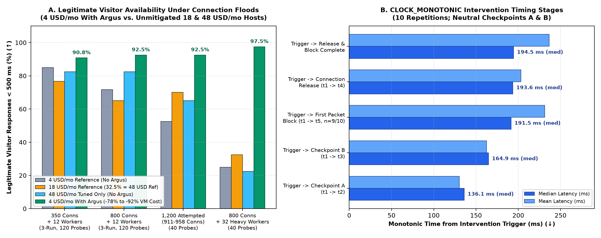

# Argus: Keeping Linux Origins Responsive Under Connection Pressure

*Standalone Linux origin-protection benchmark and redacted evidence archive by [Prometheus Dynamics](https://prometheusdynamics.ca/argus)*

**Argus protects Linux origins against excessive connection pressure. In the published external tests it blocked the offending source, released occupied connections, and preserved tested inbound management access while complementing upstream CDN protection and application-layer rate controls.**

Across **71 external flood trials**, a **`4 USD/month`** Linux/NGINX test server running Argus kept **`90.8%` to `97.5%`** of legitimate dynamic visitor HTTPS requests under `500 ms` with **`0` SSH failures** during `350`-to-`800`-connection floods that degraded unmitigated `4`, `18`, and `48 USD/month` servers (`22.5%` to `85.0%`), completing connection release in **`193.61 ms` `*(median)*`** (`203.25 ms` `*(mean)*`, range `63.27-312.64 ms`).

*Scope & disclosure note:* Monthly dollar figures compare **cloud VM infrastructure costs only** (excluding Argus software licensing or operations). Tests used a fixed, privately retained detection configuration; internal paths, service names, kernel object identifiers, polling/cap settings, and host/network identifiers are withheld in this **v4 redacted release** ([`REDACTION_MANIFEST.json`](REDACTION_MANIFEST.json)), while all 71 external probe timelines, socket counts, timing distributions, and unsuccessful boundary regimes remain inspectable via `python verify_all_figures.py`.



---

## 1. Three-Tier Instance Comparison (`4 USD/mo` With Argus vs. `4`, `18` & `48 USD/mo` Without Argus)

| Offered Connection Pressure | 4 USD/mo (1 vCPU, 512 MB)<br>Reference · Tuning only `(↑)` | 18 USD/mo (2 vCPU, 2 GB)<br>Reference · Tuning only `(↑)` | 48 USD/mo (4 vCPU, 8 GB)<br>Reference · Tuning only `(↑)` | **4 USD/mo (1 vCPU, 512 MB)**<br>**With Argus** `(↑)` | Monthly VM Infrastructure Delta `(↓)`<br>*(Excludes Argus licensing)* |
| :--- | :---: | :---: | :---: | :---: | :---: |
| **350 connections + 12 HTTPS workers** *(3 rotated runs, 120 probes)* | `85.0% · 77.5%` (102/120 · 93/120) | `76.7% · 80.8%` (92/120 · 97/120) | `81.7% · 82.5%` (98/120 · 99/120) | **90.8% (109 / 120)** | **-14 to -44 USD/mo (-78% to -92%)** |
| **800 connections + 12 HTTPS workers** *(3 rotated runs, 120 probes)* | `71.7% · 91.7%` (86/120 · 110/120) | `65.0% · 70.8%` (78/120 · 85/120) | `76.7% · 82.5%` (92/120 · 99/120) | **92.5% (111 / 120)** | **-14 to -44 USD/mo (-78% to -92%)** |
| **1,200 attempted; generator limited** *(40 probes, 911-958 conns + 16 workers)* | `52.5% · 65.0%` (21/40 · 26/40) | `70.0% · 60.0%` (28/40 · 24/40) | `57.5% · 65.0%` (23/40 · 26/40) | **92.5% (37 / 40)** | **-14 to -44 USD/mo (-78% to -92%)** |

---

## 2. Deep Stress & Sub-Threshold Boundary Comparison (`4 USD/mo` vs. `48 USD/mo`)

| Test Scenario & Worker Intensity | 4 USD/mo Without Argus (`Ref · Tuned`) `(↑)` | **4 USD/mo With Argus** `(↑)` | 48 USD/mo Without Argus (`Ref · Tuned`) `(↑)` | **48 USD/mo With Argus** `(↑)` | Measured Outcome & Boundary Finding |
| :--- | :---: | :---: | :---: | :---: | :--- |
| **350 connections + 12 HTTPS workers** *(Above tested intervention setting)* | `85.0% · 77.5%` *(3-run)* | **90.8% (109 / 120)** | `81.7% · 82.5%` *(3-run)* | **100.0% (40 / 40)** | **4 USD/mo + Argus beats unmitigated 48 USD/mo** |
| **800 connections + 12 HTTPS workers** *(Above tested intervention setting)* | `71.7% · 91.7%` *(3-run)* | **92.5% (111 / 120)** | `76.7% · 82.5%` *(3-run)* | **95.0% (38 / 40)** | **4 USD/mo + Argus beats unmitigated 48 USD/mo** |
| **800 connections + 32 heavy HTTPS workers** *(High-intensity flood)* | `25.0% · 50.0%` *(Ref SSH failed)* | **97.5% (39 / 40, p50 289.6 ms)** | `32.5% · 22.5%` *(Tuned SSH failed)* | **97.5% (39 / 40, p50 285.9 ms)** | **Matches 48 USD/mo + Argus at 97.5%** |
| **150 connections + 24 workers** *(Below tested intervention setting)* | `40.0% · 55.0%` *(0 interventions)* | `50.0% (20 / 40, 0 interventions)` | **57.5% (23 / 40 Tuned, 0 interventions)** | `37.5% (15 / 40, 0 interventions)` | **True limitation: requires Layer-7 `limit_req`** |

---

## 3. Monotonic Intervention Timing Stages (`10` Independent Repetitions, `CLOCK_MONOTONIC`)

Internal checkpoints are reported as `Checkpoint A` and `Checkpoint B` (mapping retained privately; Repetition 2 had no post-cutoff packet arrival before load-generator halt and remains explicitly `null`):

| Measured Stage (`CLOCK_MONOTONIC`) | Observed / Missing | Min (ms) `(↓)` | Median (ms) `*(median)*` `(↓)` | Mean (ms) `*(mean)*` `(↓)` | Max (ms) `(↓)` | Range (ms) |
| :--- | :---: | :---: | :---: | :---: | :---: | :---: |
| **Intervention trigger -> Checkpoint A (`t1 -> t2`)** | `10 / 0` | `8.19` | `136.08` | `130.32` | `193.13` | `8.19 - 193.13` |
| **Intervention trigger -> Checkpoint B (`t1 -> t3`)** | `10 / 0` | `37.13` | `164.89` | `162.61` | `256.58` | `37.13 - 256.58` |
| **Intervention trigger -> Connection-release completion (`t1 -> t4`)** | **10 / 0** | **63.27** | **193.61** | **203.25** | **312.64** | **63.27 - 312.64** |
| **Intervention trigger -> First observed packet block (`t1 -> t5`)** | `9 / 1` *(`Rep 02 null`)* | `161.49` | `191.48` | `231.24` | `353.02` | `161.49 - 353.02` |
| **Intervention trigger -> Both release & packet block (`max(t4,t5) - t1`)** | `9 / 1` *(`Rep 02 null`)* | `161.49` | `194.54` | `236.43` | `353.02` | `161.49 - 353.02` |

---

## 4. Shared-IP Behavior, Traffic-Handling Checks, Rollback & Cold Reboot

- **Shared-IP behavior & trusted-source exemptions (`data/argus-shared-ip-verification-2026-11-07.json`):** Simulated shared-IP concurrency at `50`, `120`, and `175` concurrent connections without exemption produced `0` incorrect interventions (`100%` `HTTP 200`), and `260` concurrent connections with a trusted-source exemption produced `0` interventions. In an intentional `240`-connection shared-IP breach test without exemption, web access from that IP was temporarily blocked (including legitimate users behind it), another visitor IP received `5/5` `HTTP 200` responses, inbound SSH on ports `22` and `2222` succeeded, and HTTPS recovered **`9.02 seconds`** after socket closure.
- **Traffic-handling, recovery & cold reboot (`data/packet_handling_verification.json`, `data/rollback_verification.json`, `data/post_reboot_verification.json`):** All `13` deterministic traffic-handling checks passed, including allowed visitor traffic, blocked web traffic, preserved inbound SSH, and rejection of source-port spoofing (outbound connections initiated to a blocked peer can remain unavailable during the block). Trusted-source exemptions, recovery after forced process termination, automatic expiry, scoped rollback preserving all unrelated routes/rules, and unattended cold-reboot external SSH access all passed.

---

## Verify the Evidence

Run the standalone standard-library verifier (`0` external dependencies):

```bash
python verify_all_figures.py
```

- **Website redacted archive (`argus-evidence-2026-11-07-v4-redacted.zip`) SHA-256:** `12c6dc185572ba259eccc7fb83cc7171c167d72914833830a14b3dcb3ecda83a`
- **Commercial evaluation inquiries:** [william@prometheusdynamics.ca](mailto:william@prometheusdynamics.ca) | [prometheusdynamics.ca/argus](https://prometheusdynamics.ca/argus)
